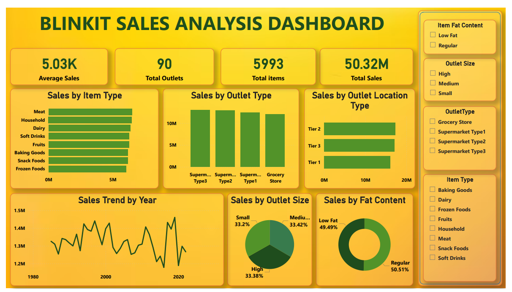

# 🛒 Blinkit Sales Analysis Dashboard

An end-to-end data analytics portfolio project using **SQL Server** and **Power BI** to explore sales performance across product categories and outlets.

## 📊 Dashboard Preview



*Dashboard screenshot provided with the project. The displayed KPI values belong to the referenced dashboard and may not match the included CSV dataset.*

## 🎯 Project Objectives

- Design a relational database using SQL Server.
- Organize data into Products, Outlets, and Sales tables with primary and foreign keys.
- Analyze sales by item type, outlet type, outlet location, outlet size, and fat content.
- Build an interactive Power BI dashboard with KPI cards, charts, and slicers.

## 🧰 Tools & Technologies

- **SQL Server / SSMS** — database creation, relational modeling, SQL queries
- **Power BI Desktop** — dashboard development and data visualization
- **Power Query** — data preparation and transformation
- **DAX** — KPI and measure calculations

## 📁 Repository Structure

```text
Blinkit_GitHub_Complete_Project/
├── README.md
├── DATASET_INFO.txt
├── PROJECT_OVERVIEW.txt
├── data/
│   └── Blinkit_10000_Rows.csv
├── sql/
│   ├── Blinkit_Sales_Analysis_SQL_Server.sql
│   └── blinkit_original.sql
├── powerbi/
│   ├── Blinkit_Sales_Analysis_Template.pbit
│   ├── DAX_Measures.md
│   └── Original_Project_Reference.pdf
└── screenshots/
    └── Blinkit_Dashboard_Screenshot.png
```

## 📦 Dataset

The included CSV contains **10,000 rows and 12 columns**:

- `Item_Identifier`
- `Item_Weight`
- `Item_Fat_Content`
- `Item_Visibility`
- `Item_Type`
- `Item_MRP`
- `Outlet_Identifier`
- `Outlet_Establishment_Year`
- `Outlet_Size`
- `Outlet_Location_Type`
- `Outlet_Type`
- `Item_Outlet_Sales`

> **Data note:** The included CSV is provided for practice and portfolio demonstration. Do not describe it as official Blinkit company data unless you independently verify its source. The screenshot is a supplied reference and may represent a different dataset/model.

## 🗄️ SQL Database Design

The SQL Server script creates three relational tables:

| Table | Purpose | Key |
|---|---|---|
| `Products` | Product attributes | `Item_Identifier` (Primary Key) |
| `Outlets` | Outlet attributes | `Outlet_Identifier` (Primary Key) |
| `Sales` | Sales records | `SaleID` (Primary Key) |

`Sales` also contains foreign keys referencing `Products` and `Outlets`.

## 🚀 How to Run the Project

### 1. Create the database

Open SQL Server Management Studio (SSMS) and run:

```sql
CREATE DATABASE BlinkitDB;
GO
```

### 2. Import the dataset

1. Right-click `BlinkitDB`.
2. Select **Tasks → Import Flat File**.
3. Choose `data/Blinkit_10000_Rows.csv`.
4. Name the imported table `Blinkit_Raw`.
5. Complete the import and verify that `dbo.Blinkit_Raw` exists.

### 3. Create the relational tables and run SQL analysis

1. Open `sql/Blinkit_Sales_Analysis_SQL_Server.sql` in SSMS.
2. Select the `BlinkitDB` database.
3. Execute the script.

The script creates the `Products`, `Outlets`, and `Sales` tables, loads data from `Blinkit_Raw`, runs validation checks, and includes sales analysis queries. It drops and recreates the three modeled tables when rerun; it does not drop `Blinkit_Raw`.

### 4. Connect Power BI to SQL Server

1. Open Power BI Desktop.
2. Select **Get Data → SQL Server**.
3. Enter your SQL Server instance and `BlinkitDB`.
4. Load the `Products`, `Outlets`, and `Sales` tables.

### 5. Verify relationships

In Power BI Model view, confirm:

- `Products[Item_Identifier]` → `Sales[Item_Identifier]` (one-to-many)
- `Outlets[Outlet_Identifier]` → `Sales[Outlet_Identifier]` (one-to-many)

### 6. Build the dashboard

Use the starter measures in `powerbi/DAX_Measures.md`. Suggested visuals:

- KPI cards: Total Sales, Average Sales, Total Products, Total Outlets
- Bar chart: Sales by Item Type
- Column chart: Sales by Outlet Type
- Bar chart: Sales by Outlet Location Type
- Donut charts: Sales by Outlet Size and Item Fat Content
- Slicers: Item Fat Content, Outlet Size, Outlet Type, Item Type

## 🔎 Analysis Questions

The included SQL queries help explore:

- What is the total and average sales amount?
- Which item types contribute the most sales?
- How do sales compare by outlet type and location?
- How does outlet size relate to sales?
- How do sales compare by item fat content?
- How do sales vary by outlet establishment year?

## 💼 Resume Project Summary

- Designed a **3-table SQL Server relational database** with primary and foreign keys to analyze **10,000 sales records**.
- Developed a Power BI dashboard using SQL, Power Query, and DAX to visualize sales by product category, outlet type, location, size, and fat content.

Update these bullets to reflect the work and results you personally completed.

## 📸 Screenshot

The dashboard image is stored at [`screenshots/Blinkit_Dashboard_Screenshot.png`](screenshots/Blinkit_Dashboard_Screenshot.png) and embedded at the top of this README.

## 📄 Additional Files

- `sql/blinkit_original.sql` — original SQL file supplied for the project
- `powerbi/Blinkit_Sales_Analysis_Template.pbit` — supplied Power BI template; configure its data source when opening
- `powerbi/Original_Project_Reference.pdf` — supplied PDF reference
- `powerbi/DAX_Measures.md` — DAX measure examples

---

**Project:** Blinkit Sales Analysis Dashboard  
**Focus:** SQL, relational database design, data analysis, Power Query, DAX, and Power BI visualization
